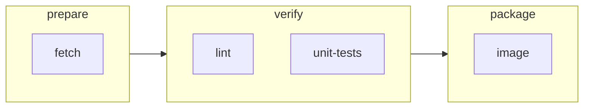
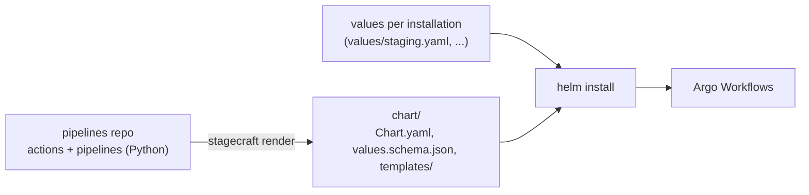

# 1. The mental model

Before writing any code, it helps to know what Stagecraft is, what it isn't, and where each
piece of a pipeline lives. Everything later in this guide builds on the ideas here.

## Pipelines, stages, steps, and actions

A **pipeline** is a CI/CD process: "check out the code, lint and test it, build an image, maybe
deploy it." Stagecraft describes it with four ideas:

- A **pipeline** is an ordered list of **stages**.
- A **stage** is a set of **steps** that run **in parallel**. The next stage starts only when
  every step in this one has succeeded.
- A **step** places an **action** in a stage under a name, and says when it runs and what
  happens around it: a condition, a GitHub check, handlers.
- An **action** is reusable work: one container that runs one command, such as "run this make
  target".

Pipelines, stages, and steps are things you **configure**. Actions are things you **write**: an
action is a small Python class that you (or an action library) define, and it is the main way you
extend Stagecraft. The same action can be placed by many steps, in many pipelines.

The split often matches two roles, even when one person plays both: **pipeline authors** arrange
steps and need only Stagecraft's vocabulary, and **action authors** write the containers behind
them.

## Four moments in a pipeline's life

A pipeline passes through four moments, and knowing which one you're in explains most of
Stagecraft's rules.

| Moment | What happens | Who does it |
|---|---|---|
| **Author time** | You write actions and pipelines in Python. | You, in a pipelines repo |
| **Render time** | `stagecraft render` compiles your pipelines into a Helm chart: an Argo Workflows `WorkflowTemplate` per pipeline (plus a `CronWorkflow` per schedule), and a values schema listing every Helm value they use. | Stagecraft |
| **Install time** | Helm checks one environment's values against that schema, fills them in, and installs the templates into a cluster. | Helm |
| **Run time** | Someone submits the template in the Argo UI (or a schedule fires), and Argo runs it. | Argo Workflows |

Two consequences:

1. **Stagecraft never talks to a cluster.** It only writes YAML files. You keep triggering and
   watching runs in the Argo Workflows UI, exactly as before.
2. **A pipeline has two kinds of inputs that arrive at different moments:**
   - **Helm values** are per *installation* (which image registry, which Secret, how much CPU).
     They are filled in at install time.
   - **Params** are per *run* (which commit, whether to deploy). They are filled in when a run
     is submitted.

## Who owns what

- The **pipelines repo** holds your actions and pipeline files. It is a plain Python project.
- **`stagecraft render` writes a complete Helm chart** from them, installed as its own release.
  Its `values.schema.json` is generated: every Helm value the pipelines use is required, with
  the type they use it as.
- **Values come at install time**, one file per environment. Helm checks them against the
  generated schema, so a missing or wrongly typed value fails the install, before any run.

Stagecraft writes `Chart.yaml`, `values.schema.json`, and `templates/`, and nothing else: never a
`values.yaml`, and never the Secrets or service accounts the pipelines refer to by name.

## What you write, what you configure, what is fixed

| You write (code) | You configure (data) | Fixed by Stagecraft |
|---|---|---|
| Action classes: their fields and the container they compile to | Pipelines, stages, steps, params, conditions, handlers, statuses, triggers | How stages become an Argo DAG, how handlers and statuses are wired, how Helm values are rendered and escaped |

Chapter 12 maps this out in detail. For now, the short version: **actions are open, the pipeline
structure is closed.** You can make an action do anything a container can do, and you combine
actions with a small, fixed vocabulary.

## Vocabulary

| Term | Meaning |
|---|---|
| Action | A Python class that compiles to one container. Reusable work. |
| Step | An action placed in a stage under a name, with optional condition, check, and handlers. |
| Stage | Steps that run in parallel. |
| Source | The repository a pipeline builds, checked out once per run at one commit. |
| Pipeline | Ordered stages, plus params, handlers, statuses, and triggers. |
| Param | A per-run input, shown in the Argo UI's submit form. |
| Helm value | A per-installation input, supplied when the chart is installed. |
| Values schema | The chart's `values.schema.json`, generated from the Helm values the pipelines use. |
| Placeholder | `{{ param.x }}`, `{{ values.a.b }}`, `{{ step.x }}`, or `{{ status.x }}` in an action's fields. |
| Handler | A step that runs after a stage, step, or pipeline finishes (`on_success`, `on_failure`, `finally_`). |
| Outcome | How a step, stage, or run ended: `succeeded`, `failed`, or `skipped`. |

Next: [2. Your first pipeline](02-first-pipeline.md), where you render one.
