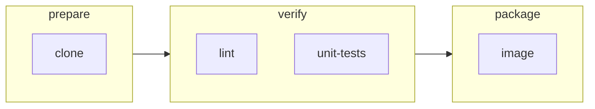
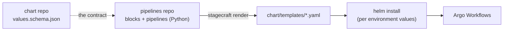

# 1. The mental model

Before writing any code, it helps to know what Stagecraft is, what it isn't, and where each
piece of a pipeline lives. Everything later in this guide builds on the ideas here.

## Pipelines, stages, and blocks

A **pipeline** is a CI/CD process: "check out the code, lint and test it, build an image, maybe
deploy it." Stagecraft describes it with three nested ideas:

- A **pipeline** is an ordered list of **stages**.
- A **stage** is a set of **blocks** that run **in parallel**. The next stage starts only when
  every block in this one has succeeded.
- A **block** is one unit of work: one container that runs one command.

Pipelines and stages are things you **configure**. Blocks are things you **write**: a block is a
small Python class that you (or a block library) define, and it is the main way you extend
Stagecraft.

## Four moments in a pipeline's life

A pipeline passes through four moments, and knowing which one you're in explains most of
Stagecraft's rules.

| Moment | What happens | Who does it |
|---|---|---|
| **Author time** | You write blocks and pipelines in Python. | You, in a pipelines repo |
| **Render time** | `stagecraft render` compiles each pipeline into an Argo Workflows `WorkflowTemplate` (plus a `CronWorkflow` per schedule) and checks every Helm value it uses against the chart's contract. | Stagecraft |
| **Install time** | Helm fills in the values for one environment and installs the templates into a cluster. | Helm, from a chart repo |
| **Run time** | Someone submits the template in the Argo UI (or a schedule fires), and Argo runs it. | Argo Workflows |

Two consequences:

1. **Stagecraft never talks to a cluster.** It only writes YAML files. You keep triggering and
   watching runs in the Argo Workflows UI, exactly as before.
2. **A pipeline has two kinds of inputs that arrive at different moments:**
   - **Helm values** are per *installation* (which image registry, which Secret, how much CPU).
     They are filled in at install time.
   - **Params** are per *run* (which commit, whether to deploy). They are filled in when a run
     is submitted.

## Who owns what

- The **pipelines repo** holds your blocks and pipeline files. It is a plain Python project.
- The **chart repo** holds a Helm chart that installs the rendered templates. It owns
  `values.yaml` and `values.schema.json`.
- The chart's **`values.schema.json` is the contract** between the two. A pipeline may only use a
  Helm value the schema guarantees; anything else fails at render time, long before a run.

Stagecraft never writes `Chart.yaml`, `values.yaml`, or the schema. It only writes templates.

## What you write, what you configure, what is fixed

| You write (code) | You configure (data) | Fixed by Stagecraft |
|---|---|---|
| Block classes: their fields and the container they compile to | Pipelines, stages, params, conditions, handlers, statuses, workspace, triggers | How stages become an Argo DAG, how handlers and statuses are wired, how Helm values are rendered and escaped |

Chapter 11 maps this out in detail. For now, the short version: **blocks are open, the pipeline
structure is closed.** You can make a block do anything a container can do, and you combine
blocks with a small, fixed vocabulary.

## Vocabulary

| Term | Meaning |
|---|---|
| Block | A Python class that compiles to one container. One unit of work. |
| Stage | Blocks that run in parallel. |
| Pipeline | Ordered stages, plus params, handlers, statuses, workspace, and triggers. |
| Param | A per-run input, shown in the Argo UI's submit form. |
| Helm value | A per-installation input from the chart's values. |
| Values contract | The chart's `values.schema.json`. |
| Placeholder | `{{ param.x }}`, `{{ values.a.b }}`, `{{ step.x }}`, or `{{ status.x }}` in a block's fields. |
| Handler | A block that runs after a step finishes (`on_success`, `on_failure`, `finally_`). |
| Step | A stage or a block: anything that can have a condition, handlers, or a status. |

Next: [2. Your first pipeline](02-first-pipeline.md), where you render one.
