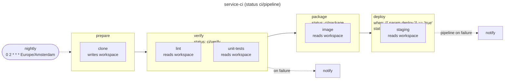

# 11. Designing pipelines

You've now seen every piece. This chapter steps back: the finished pipeline as a whole, a precise
map of what you can and can't customize, patterns for growing beyond one pipeline, and a guide
to the errors you'll meet.

## The finished pipeline

`uv run stagecraft graph pipelines --pipeline service-ci` draws the pipeline built over chapters
2 to 9:



Reading it from the left:

- **The trigger** (`nightly`) starts a run every night; people start others from the Argo UI with
  their own `repo`, `sha`, `push`, and `deploy`.
- **`prepare`** checks out the commit into the workspace (`Clone`, a writer).
- **`verify`** runs `lint` and `unit-tests` in parallel, as two containers of one pod sharing the
  read-only workspace. Its status is `ci/verify`, and its `on_failure` handler notifies the
  channel.
- **`package`** builds the image, pushing it when `push` is `true`.
- **`deploy`** only runs when `deploy` is `true`; otherwise it reports `ci/deploy` as "Skipped".
- **The pipeline's own status** `ci/pipeline` tracks the whole run, and its `on_failure` handler
  posts how a failed run ended.

Everything installation-specific (images, build resources, the channel, the token Secret's name)
comes from the chart's values, checked against its schema at every render.

## What you can customize

Stagecraft has one open extension point, a fixed vocabulary for composing it, and a few escape
valves.

### Open: blocks (code you write)

- **Fields**: any Pydantic fields, defaults, and validators. Defaults may be placeholders
  (`sha: str = "{{ param.sha }}"`), and a block may change the default of an inherited field
  (`Clone` defaults `workspace` to `"write"`).
- **`compile`**: returns any Hera `Container` or `Script`: image, command, env, Secrets by name,
  resources, retries, timeouts, service account, node selection, security context, volumes. The
  only limits: it must be pure, take installation details from `ctx`, and (inside a shared
  containerset pod) use container fields only.
- **Every role a block plays**: the work in a stage, a handler (`on_success`, `on_failure`,
  `finally_`), and the `status_reporter`. All three are ordinary blocks, so the notification
  system, the commit-status API, and every tool are your choice.
- **Block libraries**: blocks are Python, so they can be packaged, versioned, and shared.

### Configurable: the pipeline structure (data you set)

| Model | What you set |
|---|---|
| `Pipeline` | `name`, `params`, `stages`, `on_success`, `on_failure`, `status`, `status_reporter`, `workspace`, `triggers` |
| `Stage` | `name`, `blocks`, `when`, `status`, `on_success`, `on_failure`, `finally_` |
| `Block` (inherited) | `name`, `when`, `status`, `on_success`, `on_failure`, `finally_`, `workspace` |
| `Param` | `name`, `required` or `default`, `enum`, `description` |
| `Workspace` | `strategy` (`"containerset"`), `size` |
| `Trigger.cron` | schedule, `name`, `params`, `timezone` |

These models are closed: they reject unknown fields, and they aren't meant to be subclassed.
Subclass `Block` only.

### Python itself: composition

Pipeline files are Python, so functions, loops, and modules are all available for building
pipelines: factories that stamp out similar pipelines, shared stage definitions, lists of blocks
built from data. See the patterns below.

### Escape valves

- **Native Argo expressions** in block fields (`{{workflow.name}}`, `{{workflow.uid}}`) pass
  through untouched.
- **A block's container** can do anything a container can, so behavior Stagecraft doesn't model
  can live inside a block.

### Fixed: what Stagecraft decides

- How stages compile: each stage a sub-DAG of its blocks, stages in order, one `main` DAG.
- How handlers and statuses are wired (exit hooks, the `onExit` handler, report tasks) and what
  they report.
- The placeholder namespaces: `param`, `values`, `step`, `status`.
- How Helm values are rendered (always strings) and how Argo expressions are escaped.
- The available workspace strategies (`containerset`) and trigger kinds (`cron`).
- Generated names: templates are `<stage>-<block>`, `<stage>-workspace`, and so on; `main`,
  `on-exit`, `status-report`, and `status-reporter` are reserved.

If a pipeline needs something on the fixed side, that's a change to Stagecraft. The features
left out on purpose so far, and what would justify each, are in
[DESIGN.md section 15](../DESIGN.md#15-deferred-features).

## Patterns

### Factories for similar pipelines

When several repositories need the same pipeline shape, write a function that builds it. Assign
each result to a module-level name: Stagecraft collects `Pipeline` objects from module
variables, not from lists or function calls it can't see.

```python file=pipelines/libraries.py
from stagecraft.spec import Param, Pipeline, Stage, Workspace

from blocks import Clone, Make, Notify


def library_pipeline(name: str, targets: list[str]) -> Pipeline:
    """A verify-only pipeline: check out the commit, then run each make target in parallel."""
    return Pipeline(
        name=name,
        params=[
            Param("repo", required=True, description="Repository, as owner/name"),
            Param("sha", required=True, description="Commit to build"),
        ],
        workspace=Workspace(strategy="containerset", size="2Gi"),
        stages=[
            Stage("prepare", [Clone()]),
            Stage(
                "verify",
                [Make(name=target, target=target, workspace="read") for target in targets],
                on_failure=[Notify(message="{{ step.name }} failed for {{ param.repo }}")],
            ),
        ],
    )


auth_lib = library_pipeline("auth-lib-ci", ["lint", "test"])
http_lib = library_pipeline("http-lib-ci", ["lint", "test", "bench"])
```

The same idea works one level down: a function returning a `Stage`, or a list of blocks, shared
by several pipelines.

### Designing blocks people enjoy using

- **Name the intent.** `Make(target="lint")` and `Clone()` read better than shell one-liners.
- **Default the common case**, including placeholders (`repo: str = "{{ param.repo }}"`).
- **Pass fields as environment variables** rather than splicing them into scripts.
- **Take every installation detail from `ctx`**: images, Secret names, sizes.
- **Validate what you can** in field validators, remembering they see placeholders as text.
- **Test each block** with a small contract listing exactly the values it needs.

### Deciding where things go

| If it... | Make it a... |
|---|---|
| changes per run ("deploy this time?") | `Param` |
| changes per installation (registry, Secret name, CPU) | Helm value, via `ctx.value` or `{{ values.a.b }}` |
| is part of what the pipeline *is* (stages, workspace size, schedule) | literal in the pipeline file |
| is reusable work | a block |
| must run after a step whatever happens | a `finally_` handler |
| should appear as a GitHub check | `status=` on the step |

### Choosing stages

- Put independent work in the same stage so it runs in parallel.
- Start a new stage where work depends on earlier results.
- Conditions, statuses, and handlers can go on a stage or a block, but blocks that share a
  containerset pod can't have their own, so stages are often the better home for them anyway.

## A checklist for a new pipeline

1. List the steps and what each depends on; group independent steps into stages.
2. Decide the params (per run) and the Helm values (per installation) each step needs; add the
   values to the chart's schema as **required**, with defaults in `values.yaml`.
3. Reuse blocks where they exist; write and test new ones where they don't.
4. Add a workspace if steps share files: writers alone in their stage, readers grouped.
5. Add `status=` to the pipeline (and stages) that should be GitHub checks, plus a
   `status_reporter`; require the pipeline's context in branch protection.
6. Add handlers for notifications and cleanup; triggers for schedules.
7. `stagecraft check`, `stagecraft graph`, `stagecraft render`, then the chart's checks.

## Troubleshooting

The render stops at the first problem and names where it is. Common messages:

| Message (abridged) | Cause | Fix |
|---|---|---|
| `undeclared param 'sha'` | `{{ param.sha }}` with no `Param("sha")` | Declare the param |
| `'{{ step.name }}' is only available in handler blocks` | `{{ step.* }}` outside a handler | Move it into an `on_*`/`finally_` block |
| `value 'build.memory' is not declared in the values schema` | The chart's schema lacks the path | Add it to the schema (required), or fix the path |
| `value 'build.region' is optional in the values schema` | The path isn't required at every level | Mark it required and give it a default |
| `value 'build.retries' is integer in the values schema, but is used as string` | Type mismatch | Change the schema type or the type passed to `ctx.value` |
| `handler blocks cannot set when, status, or handlers` | A handler with `when=`, `status=`, or handlers | Remove them; put conditions on the owning step |
| `blocks sharing a containerset pod cannot set when, status, or handlers` | A grouped workspace block has its own `when`/`status`/handlers | Set them on the stage, or move the block to its own stage |
| `blocks sharing a containerset pod cannot set retry_strategy (template-level fields)` | A grouped block sets pod-level options | Move the block to its own stage |
| `block 'a' writes the workspace, so it must be the stage's only block using the workspace` | A writer beside other workspace blocks | Put the writer in its own stage |
| `uses the workspace; set workspace=Workspace(...)` | A block declares access but the pipeline has no workspace | Add `workspace=Workspace(...)` |
| `duplicate block name 'make'` | Two blocks of one class in a stage | Give each a `name=` |
| `must be a lowercase DNS label` | A stage or block name like `Verify` | Use `a-z`, `0-9`, `-` |
| `status contexts need a status_reporter` / `need required params 'repo' and 'sha'` | Statuses without their prerequisites | Add the reporter and the params |
| `trigger 'nightly': required param 'sha' has no value` | A trigger doesn't set a required param | Add it to the trigger's `params` |
| `template name 'a-b-c' is generated twice` | Names like stage `a` + block `b-c` and stage `a-b` + block `c` | Rename a stage or block |
| `unbalanced '{{' in rendered output` | A lone `{{` or `}}` in a field | Balance it, or move the text into a file the block reads |
| `no Pipeline found at module level` | A pipeline file without a module-level `Pipeline` | Assign the pipeline to a variable |

## Where to go next

- [Reference](reference.md): every field, placeholder, command, and naming rule on one page.
- [DESIGN.md](../DESIGN.md): why Stagecraft works the way it does, and what's deferred.

You're ready to build pipelines.
