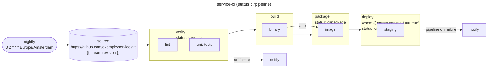

# 12. Designing pipelines

You've now seen every piece. This chapter steps back: the finished pipeline as a whole, a precise
map of what you can and can't customize, patterns for growing beyond one pipeline, and a guide
to the errors you'll meet.

## The finished pipeline

`uv run stagecraft graph pipelines --pipeline service-ci` draws the pipeline built over chapters
2 to 10:



Reading it from the left:

- **The trigger** (`nightly`) starts a run every night; people start others from the Argo UI with
  their own `revision`, `push`, and `deploy`.
- **The source** is checked out first, at the commit `revision` resolves to, and every step
  starts in that checkout.
- **`verify`** runs `lint` and `unit-tests` in parallel, each in its own pod. Its status is
  `ci/verify`, and its `on_failure` handler notifies the channel.
- **`build`** compiles the service once and publishes the binary as the artifact `app`.
- **`package`** receives `app` (the edge labelled `app`), builds the image around it, pushes it
  when `push` is `true`, and publishes the image's digest.
- **`deploy`** only runs when `deploy` is `true`, deploying the digest `package` published;
  otherwise it reports `ci/deploy` as "Skipped".
- **The pipeline's own status** `ci/pipeline` tracks the whole run, and its `on_failure` handler
  posts how a failed run ended.

Everything installation-specific (images, build resources, the channel, the Secrets' names)
comes from each installation's values, which Helm checks against the generated schema.

Steps share nothing but the source and the results they publish: each starts from its own copy
of the checkout, and receives earlier steps' artifacts and output parameters by name.

## What you can customize

Stagecraft has one open extension point, a fixed vocabulary for composing it, and a few escape
valves.

### Open: actions (code you write)

- **Fields**: any Pydantic fields, defaults, and validators. Defaults may be placeholders
  (`sha: str = "{{ source.sha }}"`).
- **`compile`**: returns any Hera `Container` or `Script`: image, command, env, Secrets by name,
  resources, retries, timeouts, service account, node selection, security context, volumes. The
  only limits: it must be pure and take installation details from `ctx`.
- **Every role an action plays**: the work in a stage, a handler (`on_success`, `on_failure`,
  `finally_`), and the `status_reporter`. All three are ordinary actions, so the notification
  system, the commit-status API, and every tool are your choice.
- **Action libraries**: actions are Python, so they can be packaged, versioned, and shared.

### Configurable: the pipeline structure (data you set)

| Model | What you set |
|---|---|
| `Pipeline` | `name`, `params`, `stages`, `on_success`, `on_failure`, `status`, `status_reporter`, `triggers` |
| `Stage` | `name`, `steps`, `when`, `status`, `on_success`, `on_failure`, `finally_` |
| `Step` | `name`, `action`, `when`, `status`, `on_success`, `on_failure`, `finally_` |
| `Param` | `name`, `required` or `default`, `enum`, `description` |
| `Trigger.cron` | schedule, `name`, `params`, `timezone` |

These models are closed: they reject unknown fields, and they aren't meant to be subclassed.
Subclass `Action` only.

### Python itself: composition

Pipeline files are Python, so functions, loops, and modules are all available for building
pipelines: factories that stamp out similar pipelines, shared stage definitions, lists of steps
built from data. See the patterns below.

### Escape valves

- **Native Argo expressions** in action fields (`{{workflow.name}}`, `{{workflow.uid}}`) pass
  through untouched.
- **An action's container** can do anything a container can, so behavior Stagecraft doesn't model
  can live inside an action.

### Fixed: what Stagecraft decides

- How stages compile: each stage a sub-DAG of its steps, stages in order, one `main` DAG.
- How handlers and statuses are wired (exit hooks, the `onExit` handler, report tasks) and what
  they report.
- The order of a run: the setup, then the source, then the stages.
- How the source is fetched (shallowly, once per run) and where steps find it.
- The placeholder namespaces: `param`, `values`, `setup`, `source`, `step`, `steps`, `status`, and the outcome words
  (`succeeded`, `failed`, `skipped`).
- How Helm values are rendered (always strings) and how Argo expressions are escaped.
- The available trigger kinds (`cron`).
- Generated names: templates are `<stage>-<step>`, and so on; `main`,
  `on-exit`, `status-report`, `status-reporter`, `setup`, and `source` are reserved, as is the
  `stagecraft` values key.

If a pipeline needs something on the fixed side, that's a change to Stagecraft. The features
left out on purpose so far, and what would justify each, are in
[DESIGN.md section 15](../DESIGN.md#15-deferred-features).

## Patterns

### Factories for similar pipelines

When several repositories need the same pipeline shape, write a function that builds it. Assign
each result to a module-level name: Stagecraft collects `Pipeline` objects from module
variables, not from lists or function calls it can't see.

```python file=pipelines/libraries.py
from stagecraft.spec import Param, Pipeline, Source, Stage, Step

from actions import Make, Notify


def library_pipeline(name: str, repo: str, targets: list[str]) -> Pipeline:
    """A verify-only pipeline: check out `repo` and run each make target in parallel."""
    return Pipeline(
        name=name,
        params=[Param("revision", default="main", description="Branch, tag, or commit")],
        source=Source(url=f"https://github.com/{repo}.git", revision="{{ param.revision }}"),
        stages=[
            Stage(
                "verify",
                [Step(target, Make(target=target)) for target in targets],
                on_failure=[Notify(message="{{ step.name }} failed at {{ source.sha }}")],
            ),
        ],
    )


auth_lib = library_pipeline("auth-lib-ci", "example/auth-lib", ["lint", "test"])
http_lib = library_pipeline("http-lib-ci", "example/http-lib", ["lint", "test", "bench"])
```

The same idea works one level down: a function returning a `Stage`, or a list of steps, shared
by several pipelines.

### Designing actions people enjoy using

- **Name the intent.** `Make(target="lint")` reads better than a shell one-liner.
- **Default the common case**, including placeholders (`sha: str = "{{ source.sha }}"`).
- **Pass fields as environment variables** rather than splicing them into scripts.
- **Take every installation detail from `ctx`**: images, Secret names, sizes.
- **Validate what you can** in field validators, remembering they see placeholders as text.
- **Test each action**, and assert `ctx.references`: it lists exactly the values it needs.

### Deciding where things go

| If it... | Make it a... |
|---|---|
| changes per run ("deploy this time?") | `Param` |
| changes per installation (registry, Secret name, CPU) | Helm value, via `ctx.value` or `{{ values.a.b }}` |
| is part of what the pipeline *is* (stages, schedule) | literal in the pipeline file |
| is reusable work | an action |
| must run after a step whatever happens | a `finally_` handler |
| should appear as a GitHub check | `status=` on the step |

### Choosing stages

- Put independent work in the same stage so it runs in parallel.
- Start a new stage where work depends on earlier results.
- Conditions, statuses, and handlers can go on a stage or a step. Put them on the stage when
  they're about the phase as a whole.

## A checklist for a new pipeline

1. List the steps and what each depends on; group independent steps into stages.
2. Decide the params (per run) and the Helm values (per installation) each step needs; add the
   values to every environment's values file.
3. Reuse actions where they exist; write and test new ones where they don't.
4. Add `status=` to the pipeline (and stages) that should be GitHub checks, plus a
   `status_reporter`; require the pipeline's context in branch protection.
5. Add handlers for notifications and cleanup; triggers for schedules.
6. `stagecraft check`, `stagecraft graph`, `stagecraft render`, then `helm template` with each
   environment's values (chapter 11).

## Troubleshooting

The render stops at the first problem and names where it is. Problems with an installation's
values show up later, at `helm template` or install: a `missing property` means a values file
lacks a value the pipelines use (or an action misspells a path); `got number, want string` means
a value needs quotes. Common render messages:

| Message (abridged) | Cause | Fix |
|---|---|---|
| `undeclared param 'sha'` | `{{ param.sha }}` with no `Param("sha")` | Declare the param |
| `use & and \| to combine conditions` / `combine comparisons in parentheses` | `and`/`or` between conditions, or `a == 'x' & b == 'y'` | `(a == 'x') & (b == 'y')` |
| `compare with a string` | `param('deploy') == True` | Compare with `'true'`: everything compared is a string |
| `'{{ step.name }}' is only available in handlers` | `{{ step.* }}` outside a handler | Move it into an `on_*`/`finally_` handler |
| `value 'build.retries' is used as str here but as int elsewhere` | Two references give one path different types | Use one type everywhere (placeholders are strings) |
| `paths must be dotted identifiers` | A key like `alert-channel` | Rename the key (`alertChannel`) |
| `'stagecraft' is reserved for framework values` | A value under `stagecraft.` | Use another top-level key |
| `handler steps cannot set when, status, or handlers` | A handler with `when=`, `status=`, or handlers | Remove them; put conditions on the owning step |
| `duplicate step name 'make'` | Two bare actions of one class in a stage | Wrap each in `Step("<name>", ...)` |
| `must be a lowercase DNS label` | A stage or step name like `Verify` | Use `a-z`, `0-9`, `-` |
| `status contexts need a status_reporter` / `need a pipeline source` | Statuses without their prerequisites | Add the reporter and a `source` |
| `'{{ source.sha }}' needs a pipeline source` | A `{{ source.* }}` placeholder in a pipeline without one | Add `source=Source(...)` |
| `'{{ steps.package.image.digst }}' is not an output of a step in an earlier stage` | A misspelled result, or one from the same or a later stage | Fix the name, or move the producing step to an earlier stage |
| `input artifact 'app' is not bound` / `has no input artifact` | `inputs=` doesn't match the action's declared input artifacts | Bind every declared input artifact, and only those |
| `comes from a step that may be skipped` | A result from a step or stage with `when` | Drop the condition, or don't depend on its results |
| `unknown setup field 'sha'; available: [...]` | `{{ setup.sha }}` names an output the setup doesn't declare | Fix the name, or add it to the `TemplateRef`'s `outputs` |
| `trigger 'nightly': required param 'env' has no value` | A trigger doesn't set a required param | Add it to the trigger's `params` |
| `template name 'a-b-c' is generated twice` | Names like stage `a` + step `b-c` and stage `a-b` + step `c` | Rename a stage or step |
| `unbalanced '{{' in rendered output` | A lone `{{` or `}}` in a field | Balance it, or move the text into a file the action reads |
| `no Pipeline found at module level` | A pipeline file without a module-level `Pipeline` | Assign the pipeline to a variable |

## Where to go next

- [Reference](reference.md): every field, placeholder, command, and naming rule on one page.
- [DESIGN.md](../DESIGN.md): why Stagecraft works the way it does, and what's deferred.

You're ready to build pipelines.
